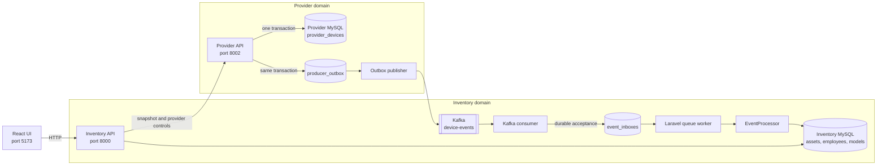

# MDM device sync case study

## Contents

1. [Case study](#1-case-study)
2. [Remaining scope](#2-remaining-scope)
3. [Codebase onboarding](#3-codebase-onboarding)
4. [Run the application](#4-run-the-application)
5. [Application behavior and mock data](#5-application-behavior-and-mock-data)
6. [Implemented design](#6-implemented-design)
7. [Data model](#7-data-model)
8. [Deletion and reconciliation](#8-deletion-and-reconciliation)
9. [Failure handling and Activity](#9-failure-handling-and-activity)
10. [API endpoints](#10-api-endpoints)
11. [Serverless alternative and cost](#11-serverless-alternative-and-cost)
12. [Verification](#12-verification)

## 1. Case study

### Context

WorkWize is an IT hardware management platform. Customers need to import assigned devices from an MDM provider. Jamf is the only provider in scope for this assignment, but the design should make additional providers possible.

The supplied task asks for a Laravel, React and MySQL application that:

- reads `files/api-mock-response.json` as a mock Jamf response;
- imports only devices assigned to an employee;
- identifies an asset by serial code and an employee by email;
- shows assets and employees in a React UI;
- deletes assets and employees only from the local database;
- recreates locally deleted data on a later sync when it still exists upstream;
- reflects assignment and attribute changes, such as a RAM update;
- runs locally with Docker Compose.

### Definitions

- **Asset:** a physical device assigned to an employee. Unassigned provider devices are not kept in local inventory.
- **Asset attributes:** device state that may vary per physical asset, such as RAM, storage and battery capacity.
- **Employee:** the current user assigned to an asset, uniquely identified locally by email.
- **Device model:** model and fixed configuration shared by assets with the same manufacturer and model identifier.

### Requirements and implementation decisions

| Requirement | Implementation |
|---|---|
| Import assigned devices | Rows without an employee email are removed or ignored |
| Asset identity | `serial_code` is unique locally |
| Employee identity | Email is unique locally |
| Reflect assignment and attribute changes | Full reconciliation and device events upsert current values |
| Recreate locally deleted data | Full reconciliation recreates assigned upstream devices and employees |
| Delete only local data from the UI | UI deletion never calls the provider delete endpoint |
| Laravel, React and MySQL | Provided through Docker Compose |
| Future providers | Provider contracts have concrete Jamf/mock adapters |

One employee can own several assets. Each asset has at most one current employee, so `assets.employee_id` is sufficient. A join table would be needed for assignment history or simultaneous many-to-many ownership.

### Solutions considered

| Solution | Decision |
|---|---|
| Full synchronization | Keep for initial import and recovery; wasteful for every change |
| Scheduled polling | Simple fallback, but repeatedly transfers unchanged data |
| `reportDate` cursor | Reject without a guarantee that all changes and removals update it |
| Increasing device ID | Reject; misses edits, unassignments and removals |
| Purchase-date filter | Reject for change detection; later changes do not alter purchase date |
| ID-only event plus provider GET | Valid and smaller, but adds a request and provider dependency |
| Complete-state event | Chosen; replay works without a provider read |
| Changed-fields-only event | Reject; partial merging makes ordering and replay harder |
| Direct outbox-to-HTTP | Simpler for one consumer; Kafka demonstrates buffering and replay |
| Kafka | Implemented with the transactional outbox |
| Serverless deployment | Viable infrastructure alternative, described below |
| gRPC | Unnecessary for query/control traffic; it does not solve persistence or detection |
| Version/hash batch API | Useful future reconciliation optimization; absent from supplied contract |

### Back-of-the-envelope estimate

Planning assumptions from the design discussion, not assignment facts or benchmarks:

- 100 customers;
- 10,000 to 1,000,000 devices per customer: 1 million to 100 million total;
- 10% annual additions/departures plus 1% replacements;
- one event per affected device: 11% of the fleet per year;
- 2 KB per complete event and 250 bytes per ID-only event.

| Total devices | Events/year at 11% | Average events/second | Complete-event traffic/year | ID-only traffic/year |
|---|---:|---:|---:|---:|
| 1 million | 110,000 | 0.0035 | 0.22 GB | 0.0275 GB |
| 100 million | 11 million | 0.35 | 22 GB | 2.75 GB |

At 2 KB per device, one complete import transfers about 2 GB to 200 GB. A daily complete import transfers about 730 GB to 73 TB per year, mostly unchanged data.

Complete events add about 0.19 GB to 19.25 GB per year over ID-only events. With 30-day retention and three copies, the difference is about 0.047 GB to 4.75 GB. Three copies are a planning assumption; the local Kafka broker has one replica.

If every device emitted one event per day, the average becomes about 12 to 1,157 events per second. Routine report/contact timestamps are therefore excluded from the event fingerprint. Kafka can buffer a burst, while database and worker capacity determine how quickly it clears.

Kafka already supports horizontal scaling. The expected load does not justify adding consumer partitions or database shards to this case study. Future changes should follow measurements:

- slow pending-row selection: add a composite outbox index for the actual query, such as status, retry time and ID;
- growing consumer lag: add partitions and consumers;
- one provider/customer being throttled: schedule work fairly by company;
- measured database throughput or storage limit: consider company-based sharding.

For a multi-customer product, add `company_id` to identities and queries so two companies can safely have the same email, serial or provider ID and cannot access each other's data. This is a data-isolation requirement before it is a sharding strategy.

### Recommendation

Use event-driven synchronization for provider changes: commit provider state and an outbox event together, publish the event to Kafka, then apply it through a durable inventory inbox. This avoids transferring the complete fleet for every change, handles bursts and lets the provider and inventory services recover independently.

The Kafka consumer runs continuously and waits for queued events. It does not poll Jamf or request the full device list. Making it wait for a user to click **Sync Now** would turn automatic event handling into user-triggered batch processing.

Keep **Sync Now** as a separate complete-snapshot reconciliation. It repairs drift after a missed or rejected event and provides the assignment-compatible JSON import path. Event processing handles normal changes; reconciliation verifies the final state.

### Delivered scope

The assignment-compatible path reads the supplied JSON through Laravel. The solution also demonstrates the recommended event-driven design discussed during the case study: a separate mock provider writes durable device events to an outbox, Kafka transports them, and the inventory service processes them without reading the full fleet for every change.

The repository does not connect to a real Jamf tenant. A real integration must verify Jamf response shapes, authentication, pagination, filters and rate limits.

## 2. Remaining scope

The delivered application is a local case study with one mock Jamf provider and one company scope. Before connecting real customers, implement:

1. **Multi-tenancy.** Add `company_id` to every tenant-owned record, event and provider connection. Replace global uniqueness with tenant-scoped unique indexes, including `(company_id, serial_code)`, `(company_id, email)` and `(company_id, provider, provider_device_id)`. Repository methods and API queries must require the authenticated company scope. Provider credentials must also be stored per company.

2. **Paginated snapshot reconciliation.** The current adapter materializes one complete response in memory. A real adapter should request every page and either stage or stream the records into one validated reconciliation run. If any page fails or the snapshot is inconsistent, fail the run without treating missing devices as removals. Only a successfully completed snapshot may remove assets by absence. Schedule this reconciliation periodically to recover missed events.

3. **Authentication and authorization.** Verify the real Jamf authentication method and keep each company's provider credentials encrypted outside application code. Authenticate application users, resolve their `company_id`, and authorize every asset, employee, sync and operational action within that company. Restrict retry/outbox controls to operational roles and disable demo endpoints outside local/testing environments.

Additional work includes a runtime provider registry to remove hard-coded provider selection, retention and archival for Kafka/inbox/outbox/rejected records, measured load testing before adding indexes or partitions beyond those required for tenant uniqueness, and mobile and screen-reader testing.

## 3. Codebase onboarding

### Start here

Read these areas in order:

1. This README for scope, behavior and design.
2. `docker-compose.yml` for process and database boundaries.
3. `backend/routes/api.php` and `backend/routes/provider-api.php` for HTTP entry points.
4. `backend/app/Providers/AppServiceProvider.php` for interface bindings.
5. `backend/app/Services/JamfSyncService.php` for inventory synchronization.
6. `backend/app/Services/IndependentProviderService.php` for provider mutations and outbox writes.
7. `frontend/src.jsx` and `frontend/views.jsx` for UI state and views.

### Repository structure

```text
.
├── backend/
│   ├── app/
│   │   ├── Contracts/             Provider, messaging and persistence interfaces
│   │   ├── Data/                  Device, snapshot and event data objects
│   │   ├── Http/Controllers/      Inventory, provider, event and demo HTTP handlers
│   │   ├── Jobs/                  Queued event processing
│   │   ├── Messaging/             Kafka publisher
│   │   ├── Models/                Eloquent models
│   │   ├── Providers/Devices/     JSON, local and HTTP provider adapters
│   │   ├── Repositories/Eloquent/ Database implementations of repository contracts
│   │   └── Services/              Sync, reconciliation, deletion and event workflows
│   ├── database/
│   │   ├── migrations/            Inventory database schema
│   │   └── provider-migrations/   Provider database schema
│   ├── routes/                    HTTP and console entry points
│   └── tests/Feature/             Backend behavior and boundary tests
├── frontend/
│   ├── src.jsx                    Application state, API calls and navigation
│   ├── views.jsx                  Assets, Employees, Activity and Testing views
│   ├── pendingNotificationsCsv.js CSV creation and download
│   └── style.css                  Shared UI styling
├── files/
│   ├── api-mock-response.json     Supplied Jamf-format fixture
│   ├── RefJamfSyncService.php     Supplied reference service
│   └── ui_design_wireframe.png    Supplied UI wireframe
├── docker-compose.yml             Complete local deployment
└── README.md                      Case study, onboarding and design documentation
```

### Generated and installed files

These areas are framework or tool output and are not the case-study implementation:

- `backend/vendor/` contains Composer dependencies;
- `frontend/node_modules/` contains npm dependencies;
- `frontend/dist/` contains the generated frontend build;
- `backend/storage/` contains Laravel runtime files;
- `composer.lock` and `package-lock.json` are dependency lock files;
- much of `backend/config/`, `bootstrap/`, `public/` and `artisan` comes from the Laravel project skeleton.

The application-specific logic is concentrated in `backend/app`, the migrations, routes, feature tests, the four authored frontend source files, Docker Compose and this README.

### Runtime services

The same Laravel source runs as two independent application roles. `APP_ROLE` selects the role; this is a deployment role, not a user permission.

| Compose service | Responsibility |
|---|---|
| `provider-mysql` | Provider devices, versions, tombstones and producer outbox |
| `provider` | Laravel mock-provider HTTP API on port 8002 |
| `publisher` | Reads due outbox rows and publishes them to Kafka |
| `kafka` | Event transport and retained replay |
| `mysql` | Inventory, sync history, inbox and Laravel jobs |
| `backend` | Laravel inventory HTTP API on port 8000 |
| `consumer` | Reads Kafka, validates messages and stores the durable inbox |
| `worker` | Processes saved inbox events through Laravel jobs |
| `frontend` | React/Vite UI on port 5173 |

The provider and inventory roles use separate MySQL servers, credentials, migrations and volumes. `PROVIDER_MODE=remote` binds the inventory service to the provider HTTP adapter in Docker.

### Main interfaces and implementations

The adapter pattern uses contracts; it does not require a shared abstract base class.

| Interface | Purpose | Current implementation |
|---|---|---|
| `DeviceProvider` | Read and parse a complete provider response | `JamfMockProvider` |
| `TargetedDeviceProvider` | Read one device or a complete snapshot | `HttpMockProviderAdapter`; local compatibility uses `MockProviderAdapter` |
| `RemoteProviderGateway` | Snapshot/import, outbox controls and provider CRUD | `HttpMockProviderAdapter` |
| `EventPublisher` | Publish one complete event | `KafkaEventPublisher` |
| Persistence contracts | Assets, employees, models, syncs, inbox, checkpoints and outbox | Classes under `Repositories/Eloquent` |
| `TransactionBoundary` | Execute application work in an inventory transaction | `DatabaseTransactionBoundary` |

Bindings live in `AppServiceProvider`. Some repository contracts still return Eloquent types, so the application is not completely independent of Laravel.

### Important services

| Service | Responsibility |
|---|---|
| `IndependentProviderService` | Provider CRUD, imports, versions, generation and transactional outbox |
| `ProducerOutboxPublisher` | Publish pending events and record acknowledgement or retry state |
| `KafkaNotificationReceiver` | Validate Kafka records and durably accept or quarantine them |
| `EventReceiver` | Deduplicate incoming events, store inbox rows and dispatch jobs |
| `EventProcessor` | Apply stored events while enforcing ordering |
| `JamfSyncService` | Record and execute full, provider, event and restoration syncs |
| `RemoteProviderSyncService` | Reconcile versioned snapshots and targeted lookups |
| `DeviceReconciler` | Apply normalized state to employees, models, assets and attributes |
| `AssetDeletionService` | Enforce local-only asset and employee deletion |
| `DemoControlService` | Reset, failure simulation and Provider Lab operations |

### Where to make common changes

| Change | Start here |
|---|---|
| Map another Jamf field | `JamfMockProvider`, data objects, migrations and `DeviceReconciler` |
| Add another provider | Provider contracts, new adapter, provider registry and credentials |
| Change asset or employee persistence | Persistence contract, Eloquent repository and migration |
| Change event fields | `DeviceEvent`, provider normalization and event tests |
| Change synchronization rules | `JamfSyncService`, `RemoteProviderSyncService`, `DeviceReconciler` |
| Change delivery retries | `ProducerOutboxPublisher`, Kafka commands and outbox repository |
| Change UI behavior | `frontend/src.jsx`, `frontend/views.jsx`, `frontend/style.css` |
| Add a local demonstration | `DemoControlService`, `DemoController`, local routes and Testing UI |

## 4. Run the application

Docker Desktop is the only host runtime required.

```sh
docker compose up --build
```

- UI: http://localhost:5173
- Inventory API: http://localhost:8000/api/assets
- Mock provider API: http://localhost:8002/api/provider/snapshot

On fresh volumes, the provider initializes from the supplied JSON. Seven device events flow through Kafka and populate seven assigned assets and six employees. Existing volumes retain their state.

Stop the application with:

```sh
docker compose down
```

Delete both MySQL volumes and the Kafka volume with:

```sh
docker compose down -v
```

## 5. Application behavior and mock data

### User interface

- **Assets** lists devices and opens details directly below the selected row.
- **Employees** lists active employees and opens their contact data and assigned devices below the row.
- **Activity** shows provider notifications waiting for Kafka and inventory events that exhausted automatic retries. Pending delivery rows can be exported as CSV or processed manually.
- **Testing** resets the demo, creates a deterministic Kafka-delivery failure, changes provider devices through Provider Lab, lists locally deleted assets and shows technical history.

Provider Lab writes provider state and a durable outbox notification. The normal Kafka path can update inventory asynchronously. **Sync Now** explicitly fetches the complete provider snapshot and reconciles inventory, including recovery from a missed event.

### Purpose of the JSON fixture

`files/api-mock-response.json` represents one complete Jamf API response. It is not an event log and does not contain created, updated or skipped counters. The inventory service calculates those counters by comparing provider state with local state.

There are two sync paths:

1. `POST /api/sync` is assignment-compatible. Laravel reads the JSON, sends it through the provider import boundary and reconciles the returned versioned snapshot.
2. **Sync Now** calls `POST /api/sync/provider`. It reads the provider's current HTTP snapshot, not the file.

Provider POST, PATCH and DELETE operations update the provider database and create outbox events. Event workers process saved event payloads without reading the JSON or fetching the entire provider snapshot.

**Reset demo** reloads provider state from the fixture, removes the reset-generated outbox rows and clears inventory. **Sync Now** repopulates inventory from the current snapshot. An event already in Kafka can arrive between reset and Sync Now because the three systems are separate. Provider generations and device versions remain monotonic, so after reconciliation an older event cannot overwrite the current snapshot.

### Source-field mapping

| Mock response field | Local use |
|---|---|
| `id` | `provider_device_id`; upstream identity for events and targeted lookups |
| `hardware.serialNumber` | `assets.serial_code`; physical-asset identity |
| `userAndLocation.email` | Employee identity and assignment signal |
| `username`, `realname`, `position`, `phone` | Employee metadata |
| `general.name`, `udid`, purchasing fields | Asset metadata |
| Manufacturer, model identifier, model, platform, processor and cores | Shared device-model/configuration data |
| RAM, storage and battery | Per-asset attributes |
| `general.reportDate` | Freshness watermark; an older report cannot overwrite newer asset state |
| `general.lastContactTime` | Stored but excluded from semantic event detection |
| `general.site.id`, `general.site.name` | Asset site; `-1` and `None` become `null` |

Site is separate from assignment. Employee email alone determines whether a device is assigned.

Manufacturer, model identifier, model name, platform, processor and core count are treated as fixed shared configuration. Conflicting non-null values for the same manufacturer and model identifier reject the change. Missing values do not erase known values. If a real provider permits processor or core upgrades without changing the model identifier, those fields should move to the asset level or a separate configuration entity.

JSON order, increasing provider IDs, purchase date and report date are not change cursors. None reliably represents edits and removals under the supplied contract.

## 6. Implemented design

### Architecture



The UI calls only the inventory API. Sync Now and Provider Lab are proxied through the inventory service's `RemoteProviderGateway`; the browser does not receive provider database credentials.

### Design patterns used

| Pattern | Use in this repository |
|---|---|
| Adapter | `DeviceProvider`, `TargetedDeviceProvider` and `RemoteProviderGateway` isolate provider-specific formats and transport |
| Repository | Most inventory persistence is behind contracts with Eloquent implementations; provider mutation and outbox publishing still use Eloquent/DB directly |
| Dependency injection | `AppServiceProvider` selects concrete adapters and repositories |
| Transactional outbox | Provider state and its outgoing event commit together |
| Durable inbox and idempotent consumer | Events are stored before Kafka acknowledgement and duplicates are safe |
| Policy object | `SharedMetadataPolicy` protects shared employee/model data from older cross-device events |
| Data transfer objects | `DeviceRecord`, `DeviceEvent` and `DeviceSnapshot` carry normalized provider data |
| Transaction boundary | Application services group inventory writes and checkpoints atomically |

The design is event-driven but is not event sourced: current inventory tables remain the system's local read state, and events are retained for delivery/recovery rather than used to rebuild every domain record permanently.

### Event path

```text
Provider POST / PATCH / DELETE
  -> provider_devices + producer_outbox in one MySQL transaction
  -> publisher sends the saved event to Kafka
  -> consumer validates and saves it in event_inboxes
  -> consumer commits the Kafka offset after durable acceptance
  -> ProcessDeviceEvent job applies the stored event
  -> React reads the resulting inventory through HTTP APIs
```

Each event carries an event ID, provider device ID, device version, provider generation, lifecycle type and complete relevant device state. Complete state avoids a provider GET for every event, at the cost of a larger message.

### Delivery and processing

Provider mutations lock the provider generation row, validate identities, update provider state, increment versions/generation and insert outbox records inside one transaction. If any write fails, all changes roll back.

Kafka publication is asynchronous. The publisher selects pending rows, publishes complete events keyed by `jamf|provider_device_id`, waits for broker acknowledgement and then marks the row published. A failed publication leaves the row pending with its error and retry time.

The consumer disables automatic offset commits. It validates each Kafka record and stores it through `EventReceiver`. It commits the offset only after the inbox accepts the event. Invalid JSON, invalid schemas and conflicting messages are saved in `rejected_notifications` before their offsets are acknowledged. Database failures are not acknowledged and Kafka redelivers them.

`ProcessDeviceEvent` references the saved inbox ID. `EventProcessor` applies the payload, ordering checkpoint and completion status in one inventory transaction. The worker never reads the JSON fixture or provider API.

### Full reconciliation

```text
React Sync Now
  -> POST /api/sync/provider
  -> HttpMockProviderAdapter
  -> complete provider snapshot
  -> RemoteProviderSyncService
  -> DeviceReconciler
  -> inventory tables and SyncRun counters
```

Full reconciliation is required for initial import and recovery. It is manual in this case study. Absence counts as removal only in a validated complete snapshot. A real paginated adapter must read every page before applying that rule.

A snapshot older than an already applied event is rejected. An equal version with different meaningful state is also rejected. Reconciliation records current versions so a delayed event cannot reverse the snapshot.

### Provider Lab

```text
Testing form
  -> local/testing demo endpoint
  -> RemoteProviderGateway create/patch/delete
  -> provider transaction and outbox event
  -> UI reports the provider change

Sync Now
  -> provider snapshot
  -> inventory reconciliation
  -> refreshed Assets and Employees
```

Provider Lab does not run reconciliation directly. The background event pipeline remains active, while Sync Now gives the reviewer an explicit reconciliation workflow.

### Device and shared ordering checkpoints

`device_event_states` stores the newest accepted version for each provider device. If device `101` reached version 6, a delayed version 5 event is stale and cannot overwrite or recreate it.

`shared_event_states` protects employee and model data that can arrive through different device keys. For example:

```text
Device 101, generation 20: Alex is a Senior Engineer
Device 103, generation 15: Alex is a Backend Engineer
```

The second event may contain a valid update for device `103`, so the device portion is processed. Its employee fields are older than Alex's generation-20 checkpoint and are ignored.

| Column | Meaning |
|---|---|
| `provider` | Provider namespace, currently `jamf` |
| `kind` | `employee` or `model` |
| `identity` | Employee email or `manufacturer|model_identifier` |
| `generation` | Newest accepted provider generation |
| `fingerprint` | Hash of shared fields at that generation |

`provider + kind + identity` is unique. Older generations cannot update shared fields. The same generation with a different fingerprint is rejected. The table holds only the latest ordering checkpoint; actual records remain in `employees` and `device_models`.

### Why outbox, Kafka and inbox are all present

MySQL and Kafka cannot participate in one atomic transaction in this design.

- The **provider outbox** commits provider state and the notification together.
- **Kafka** buffers bursts, separates producer and consumer availability, and permits replay during retention.
- The **inventory inbox** makes receipt durable before the Kafka offset is committed.
- Event IDs and versions make repeated delivery safe.

A database transaction and a lock solve different problems. The transaction keeps writes atomic. The lock prevents concurrent mutations from racing. The provider and inventory lock only their own databases.

The local broker has three partitions, one replica, seven-day retention and a persistent volume. This is the case-study topology, not a capacity or availability claim.

## 7. Data model

### Inventory database

| Entity | Purpose |
|---|---|
| `employees` | Active employees and contact metadata |
| `deleted_employees` | Original employee ID, email and deletion time after local deletion |
| `device_models` | Shared manufacturer, model identifier, model, platform, processor and cores |
| `assets` | Physical asset, employee/model references, provider identity, purchase, report/contact and site data |
| `asset_attributes` | One row per asset for RAM, storage and battery |
| `deleted_assets` | Provider ID, serial, device name and deletion time retained after local deletion |
| `sync_runs` | Sync mode, status, counters, timestamps and errors |
| `event_inboxes` | Durable event payload, processing status, attempts and errors |
| `device_event_states` | Latest accepted state/version per provider device |
| `shared_event_states` | Ordering checkpoints for shared employee and model data |
| `sync_locks` | Inventory lock for sync/event/recovery transactions |
| `jobs`, `failed_jobs` | Laravel queue storage and terminal failures |
| `rejected_notifications` | Invalid or conflicting Kafka records |

Core constraints:

| Table | Main columns and rules |
|---|---|
| `employees` | `id` primary key; `email` unique; username, name, position, phone; timestamps |
| `deleted_employees` | `employee_id` primary key; `email` unique; `deleted_at`; no duplicated personal metadata |
| `device_models` | `id`; manufacturer + model identifier unique; model, platform, processor and cores; no timestamps |
| `assets` | `id`; serial unique; employee/deleted-employee and model references; provider + provider device ID unique; name, UDID, purchase, report/contact and site fields; timestamps |
| `asset_attributes` | One row per asset; RAM, storage and battery; timestamps |
| `deleted_assets` | Provider, provider device ID, serial, name and deletion time; provider + serial unique |

An imported asset points to either an active employee or a deleted-employee identity. Unassigned provider devices are removed rather than stored with both references empty.

### Provider database

| Entity | Purpose |
|---|---|
| `provider_devices` | Current provider state, device version, generation and removal tombstone |
| `provider_generation` | Monotonic provider sequence and transaction lock |
| `producer_outbox` | Event payload, status, attempts, error, retry time and publication time |

The provider and inventory databases have different credentials. Provider migrations live in `backend/database/provider-migrations`; inventory migrations live in `backend/database/migrations`.

Repository interfaces form most of the inventory database boundary, and their Eloquent implementations contain those queries. Provider-domain services and the outbox publisher still access Eloquent/DB directly. The database is not exposed as a separate network service.

`provider_device_id` is the upstream record identity used for events, versions and targeted lookups. Serial code identifies the physical asset locally. Both are retained because they solve different identity problems.

## 8. Deletion and reconciliation

### Local asset deletion

1. Save provider ID, serial, device name and deletion time in `deleted_assets`.
2. Delete the local asset and its cascading attributes.
3. Keep the employee and provider state unchanged.
4. Show the retained identity under Testing.

There is no restore button. Sync Now performs complete reconciliation, so an assigned asset that still exists upstream reappears. `POST /api/restorations` also provides targeted recovery by provider ID but is not exposed in the UI.

### Local employee deletion

The active employee row is removed. `deleted_employees` stores only the original ID, email and deletion time. Linked assets set `employee_id` to `null` and retain `deleted_employee_id`, so they display `Deleted user (email)` without keeping the employee active.

An assigned-device event, complete reconciliation or targeted recovery recreates the employee with the same internal ID, relinks retained assets and removes the tombstone. Provider IDs on the assets identify the upstream devices; the deleted-employee row does not duplicate that list.

### Provider removal or unassignment

A provider removal or missing employee email removes the local asset because only assigned devices are imported. It does not delete the employee. Provider DELETE retains a provider tombstone and emits `device.removed`; unassignment emits `device.unassigned`.

`report_date` is a freshness watermark, not an event cursor. `report_date` and `last_contact_at` do not trigger events by themselves, which prevents routine reporting timestamps from flooding Kafka.

## 9. Failure handling and Activity

| Failure | Implemented behavior |
|---|---|
| Provider change succeeds but outbox insert fails | The provider transaction rolls back both |
| Kafka publication fails | Outbox row remains pending with retry information |
| Publisher crashes after Kafka accepts the event | Event may be resent; the inventory inbox deduplicates it |
| Consumer stops before offset commit | Kafka redelivers; the inbox deduplicates it |
| Queue dispatch fails | Pending inbox row is recovered and dispatched again |
| Invalid or conflicting Kafka record | Saved in `rejected_notifications` before acknowledgement |
| Worker attempt fails | Inventory changes roll back and the inbox becomes `retrying` |
| Worker exhausts three attempts | Inbox becomes `failed` and appears in Activity for manual retry |
| Older event arrives late | Device version and provider generation prevent regression |
| Reconciliation races with an old event | Reconciliation records the current version and the old event is ignored |

Delivery is at least once. HTTP 202 from the event-ingestion endpoint means the inbox saved the event; it does not mean inventory processing finished.

Activity shows two failure boundaries:

1. **Provider delivery:** pending outbox rows with device name, serial, event type, provider ID, attempts, error and retry time. The UI displays at most 100 rows, identifies truncation, exports the displayed rows to CSV and can process up to ten rows immediately.
2. **Inventory processing:** only events that exhausted all three automatic attempts. Each row identifies the affected device and employee and offers a retry. Full payloads and exceptions remain in `event_inboxes` and `failed_jobs` for debugging.

The deterministic **Simulate Kafka failure** control creates the same durable pending-outbox state that a failed publication would leave; it does not stop Kafka. Automatic retries continue, and Activity can process the deferred row immediately.

Demo reset/failure and Provider Lab routes are registered only for local/testing use. Provider database credentials never reach the inventory service.

## 10. API endpoints

### Provider API: port 8002

| Method | Endpoint | Purpose |
|---|---|---|
| GET | `/api/provider/snapshot` | Complete versioned state, including removal tombstones |
| GET | `/api/provider/devices/{providerId}` | One versioned device or tombstone |
| POST | `/api/provider/devices` | Create provider state and an outbox event |
| PATCH | `/api/provider/devices/{providerId}` | Apply partial changes; serial cannot change |
| DELETE | `/api/provider/devices/{providerId}` | Retain a tombstone and create a removal event |
| POST | `/api/provider/import` | Import a complete raw Jamf-format response |
| POST | `/api/provider/scan` | Compare the fixture with provider state and emit semantic changes |
| POST | `/api/provider/seed` | Initialize an empty provider store once |
| GET | `/api/provider/outbox` | Pending count and up to 100 summaries |
| POST | `/api/provider/outbox/retry` | Immediately process up to ten pending events |
| POST | `/api/provider/testing/reset` | Local/testing reset |
| POST | `/api/provider/testing/kafka-failure` | Local/testing deterministic failure |

### Inventory API: port 8000

| Method | Endpoint | Purpose |
|---|---|---|
| GET | `/api/assets`, `/api/assets/{id}` | List assets and read details |
| GET | `/api/employees`, `/api/employees/{id}` | List employees and read complete employee details |
| DELETE | `/api/assets/{id}` | Delete only the local asset and retain recovery identity |
| DELETE | `/api/employees/{id}` | Delete only the active employee and retain identity |
| POST | `/api/sync` | Direct fixture import and reconciliation |
| POST | `/api/sync/provider` | Reconcile with provider state; used by Sync Now |
| GET | `/api/deleted-assets` | List local asset deletions |
| POST | `/api/restorations` | Targeted provider lookup and recovery; no UI action |
| GET | `/api/sync-runs` | Recent sync outcomes and counters |
| POST | `/api/events/jamf` | HTTP/test ingestion into the durable inbox |
| GET | `/api/events` | Technical processing history |
| GET | `/api/event-failures` | Actionable permanent inventory failures |
| POST | `/api/events/{id}/retry` | Retry a failed inventory event |
| GET | `/api/provider-outbox` | Proxy pending outbox summaries for Activity/CSV |
| POST | `/api/provider-outbox/retry` | Proxy manual outbox processing |
| POST | `/api/simulator/jamf` | Technical fixture scan; not shown in UI |
| POST | `/api/demo/reset` | Reset provider fixture state and inventory |
| POST | `/api/demo/kafka-failure` | Create one deterministic pending notification |
| POST | `/api/demo/provider-devices` | Provider Lab create |
| PATCH | `/api/demo/provider-devices/{providerId}` | Provider Lab name/RAM update |
| DELETE | `/api/demo/provider-devices/{providerId}` | Provider Lab remove |

The local operational endpoints are unauthenticated for this case study. They need restricted, company-scoped access before a multi-customer deployment.

## 11. Serverless alternative and cost

An alternative deployment can keep the same domain and adapter boundaries while replacing always-running processes:

```text
React on S3/CloudFront
  -> API Gateway HTTP API
  -> Lambda provider/API functions
  -> Aurora MySQL Serverless for provider and inventory persistence
  -> scheduled Lambda outbox publisher
  -> SQS with dead-letter queue
  -> Lambda inventory worker
```

SQS is sufficient for the estimated traffic and simpler to operate than Kafka. Use FIFO message groups only if strict queue-level device ordering is required; versions and idempotency remain necessary. EventBridge Scheduler can run reconciliation and the outbox relay. Cognito or an existing identity provider can carry the authenticated company identity.

This illustrative monthly event-path estimate uses 9,167 to 916,667 events, public US pricing, a 2 KB message, a 512 MB Lambda running for 500 ms, one HTTP API request and three SQS operations per event. Free tiers are excluded.

| Component | Low estimate | High estimate |
|---|---:|---:|
| Lambda duration | $0.04 | $3.82 |
| Lambda requests | below $0.01 | $0.18 |
| API Gateway HTTP API | $0.01 | $0.92 |
| SQS requests | $0.01 | $1.10 |
| **Event-path subtotal** | **about $0.06/month** | **about $6.02/month** |

Database capacity/storage, backups, network/NAT use, user-facing reads, reconciliation, security, support and observability are excluded and may dominate. Current prices should be checked with the [AWS Lambda](https://aws.amazon.com/lambda/pricing/), [API Gateway](https://aws.amazon.com/api-gateway/pricing/), [SQS](https://aws.amazon.com/sqs/pricing/), [Aurora](https://aws.amazon.com/rds/aurora/pricing/) and [CloudWatch](https://aws.amazon.com/cloudwatch/pricing/) calculators.

Logging cost should be controlled at the source: structured error/state-transition logs, metrics for counts, no log per unchanged asset, sampled diagnostics, short searchable retention and object-storage archival. Grafana Cloud or Datadog can receive OpenTelemetry data, but neither is automatically cheaper; ingestion, indexing and retention determine cost.

A previous Prime Video subscription and buy/rent workload serving millions of customers in North America cost the team about 7–8k per month. Its currency, traffic profile and service breakdown were not supplied, so it is context rather than this system's forecast. It shows that customer traffic and observability can cost much more than the small event path above.

## 12. Verification

The backend suite completed with **66 tests and 438 assertions**. Laravel formatting and the React production build also completed successfully.

Test groups:

- `InventorySyncTest`: assignment synchronization and reconciliation edge cases;
- `ProviderLifecycleTest`: provider lifecycle and local restoration;
- `IndependentProviderTest`: separate provider state and outbox behavior;
- `RemoteProviderSyncTest`: HTTP adapter, recovery fencing and Provider Lab;
- `EventSyncTest`: event ordering, duplicates, stale events and shared metadata;
- `KafkaNotificationReceiverTest`: durable receipt, offsets and quarantine;
- `EmployeeTombstoneTest`: deleted identity and restoration paths;
- `PersistenceBoundaryTest`: transaction rollback behind repositories;
- `NumericStateTest`: numeric comparison after JSON/database round trips.

Backend tests:

```sh
docker compose --profile test run --rm --build backend-tests
```

Laravel formatting:

```sh
docker compose --profile test run --rm backend-tests php vendor/bin/pint --test
```

Frontend build:

```sh
docker compose run --rm --no-deps --build frontend npm run build
```

Browser verification covered:

- reset followed by Sync Now restores seven assets;
- asset and employee details render below the selected row;
- a late details response does not change the user's current tab;
- deterministic Kafka failure remains pending across automatic cycles;
- Activity displays device, serial, type and retry time;
- pending rows export to CSV and manual processing clears the outbox;
- Provider Lab creates, updates and removes provider state before explicit reconciliation.
