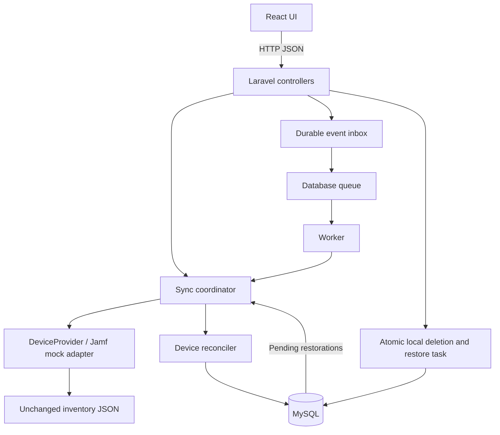
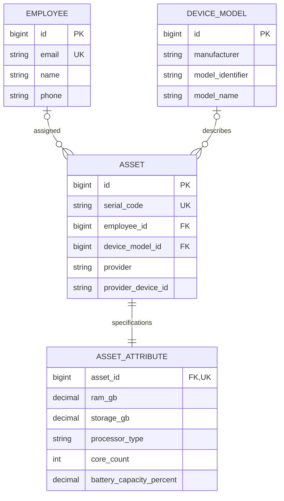

# Final event-driven solution design

## Scope
Deliver Laravel + React + MySQL in Docker Compose. Laravel directly reads the unchanged files/api-mock-response.json; React uses HTTP APIs. Full manual Sync Now imports assigned devices, updates attributes and assignments, recreates deleted records, and yields 7 assets / 6 employees initially. JamfSyncService is our Laravel code, not external Jamf. External Jamf is not modified. Simulated events are separate messages; actual webhook payloads/coverage must be verified later.

## Architecture and interfaces
React -> thin Laravel controllers -> SyncCoordinator -> DeviceReconciler -> Eloquent/MySQL. DeviceProvider contract exposes snapshot() and findByProviderId(id). JamfMockProvider reads/validates/maps the file to normalized records. All reconciliation uses that common format. SyncCoordinator owns locking, run lifecycle and counts. AssetDeletionService owns delete/restore tracking. EventReceiver owns durable intake; queued ProcessDeviceEvent owns execution. Dependency injection binds the provider interface. Single responsibility and dependency inversion guide these boundaries; avoid generic repository wrappers around Eloquent.

Events flow: receiver -> durable inbox -> Laravel database queue -> worker -> adapter current-device lookup -> transaction reconciliation -> inbox completed. Kafka/gRPC are unnecessary locally. A worker container uses the same Laravel code. Full sync remains for initial import and reconciliation. Mock targeted lookup still reads the full file; it does not claim fewer external reads. Future HTTP adapter could fetch only affected IDs. reportDate is provenance, not an assumed complete checkpoint; purchase date cannot detect later changes.

## Models
Employee: internal id, unique normalized email, nullable name/phone. One employee has many assets.
DeviceModel: id, manufacturer, model_identifier, model_name; unique manufacturer + model_identifier. Shared metadata is descriptive, not immutable. Missing identifiers allow null asset model link.
Asset: id, unique normalized serial_code, nullable employee_id FK, nullable device_model_id FK, device_name, provider, provider_device_id, optional udid/purchased/purchase_date/report_date. Unique provider + provider_device_id when present. Serial is the upsert identity.
AssetAttributes: unique asset_id FK cascading on deletion; nullable ram_gb/storage_gb/processor_type/core_count/battery_capacity_percent. These are per-device mutable properties. RAM conversion follows reference division by 1024, documented in UI.
SyncRun: provider, mode full/event/restore, status in_progress/succeeded/failed, started_at/completed_at, counters JSON, error_details. Failure survives reconciliation rollback.
EventInbox: unique event_id, provider, provider_device_id, type, payload JSON, status pending/processing/succeeded/failed, attempts, processed_at, last_error. Conflicting reuse of an ID is rejected.
RestoreTask: provider/device identity and serial, deleted_at, status pending/restored/upstream_missing/upstream_unassigned, attempts, error. Retained independently from deleted Asset.
Laravel jobs/failed_jobs: durable execution and retry diagnostics.
No EmployeeAsset join entity: current employee FK fits one assignee; history is outside scope. No fake incremental checkpoint when source offers none. Production would namespace identity/state by customer.

## Final assumptions awaiting company answers
Employee deletion hard-deletes employee and sets related assets employee_id null. Full sync restores assignments. This temporary local unassigned state is explicit.
An existing device becoming unassigned removes its local asset, but keeps employee. A device missing from a validated complete snapshot is removed. Reject malformed/truncated envelopes and totalCount mismatches before any removals. Failed snapshots do not cause deletion.
Explicit source null clears nullable values; missing optional fields preserve existing values where practical, using field-presence information. Document snapshot-only simplifications honestly.
Reject duplicate serials and conflicting provider identities before writes. Employee/model metadata conflicts are resolved by deterministic provider-ID order and warned, not input order.
Local asset delete and RestoreTask creation are atomic. Full sync restores naturally; a restore endpoint targets pending identities and does not recreate upstream-missing or unassigned devices.
Events always fetch latest state; they do not apply stale patches. Manual/worker writes share a database-backed lock. Duplicate notifications are safe. Receipt commits inbox before HTTP 202; pending inbox recovery closes queue dispatch failure gaps. Bounded retries and failed diagnostics remain visible.

## API and UI
GET /api/assets (paginated, nested employee/model/attributes), GET /api/assets/{id}, GET /api/employees (assigned asset summaries), DELETE /api/assets/{id}, DELETE /api/employees/{id}, POST /api/sync, GET /api/sync-runs, POST /api/events/jamf, GET /api/events, POST /api/restorations.
Simulated event input: event_id, provider_device_id, type=device.changed|device.removed. This is our demo schema, not a claim about Jamf schema. Real webhook authentication is not implemented; bind the local demo to localhost.
React Assets/Employees tabs, details, delete confirmations, loading/errors, summary and event-demo panel. No manual create/edit. Users edit mounted fixture separately to simulate source changes. Original fixture remains unchanged in Git.

## Atomic implementation plan
1. Commit design before code.
2. Bootstrap Laravel/React and Docker startup.
3. Add constrained schema/models.
4. Add adapter/full reconciliation and meaningful tests.
5. Add deletion/restoration and tests.
6. Add durable event intake/worker/retry and tests.
7. Add API/UI and build checks.
8. Document startup, assumptions and measured verification limits.
Each step is a small atomic commit. No publish/PR required. Docker became available after the user restarted it; root verification will report actual container results separately. Use available npm at C:/Program Files/nodejs/npm.cmd; no global runtime installations.

## Verification
Test initial 7/6, unchanged repeat, RAM update, reassignment, null handling, duplicate rollback, delete recreation, employee deletion, unassignment/missing policies, malformed snapshot no deletions, event idempotency/conflicting IDs, targeted current-state lookup, failed event persistence/retry and restoration. Frontend build and browser/API checks when runnable. SQLite tests do not prove MySQL locks/constraints; report real-MySQL coverage separately.

## Future production extension
Verify Jamf event support, signatures, timestamps, batch/targeted endpoints. Add authenticated webhook integration, tenant-scoped identities, provider checkpoints only when supported and scheduled authoritative reconciliation. Local CRUD does not emit upstream events; restoration remains independent. Serverless execution is a deployment option, not required for event-driven processing.

## Architecture diagram


## Entity relationships

The nullable relationships reflect missing model identity and the temporary state after local employee deletion. Restore tasks and event inbox rows intentionally do not cascade with assets, because they must survive asset deletion.

## API examples
Manual reconciliation:
```http
POST /api/sync
Accept: application/json
```
Response contains the persisted SyncRun, its status and counters such as created_assets, updated_assets and unchanged_assets.

Simulated notification (not an actual Jamf payload):
```http
POST /api/events/jamf
Content-Type: application/json

{"event_id":"demo-101-001","provider_device_id":"101","type":"device.changed"}
```
HTTP 202 means durably accepted, not processed. GET /api/events exposes completion and error status. Reusing the same event ID and payload does not apply a second independent event.

Restore local deletions without a full reconciliation:
```http
POST /api/restorations
Accept: application/json
```
The mock adapter still reads the file once. Only pending restore identities are reconciled; unrelated inventory is not updated by this operation.

