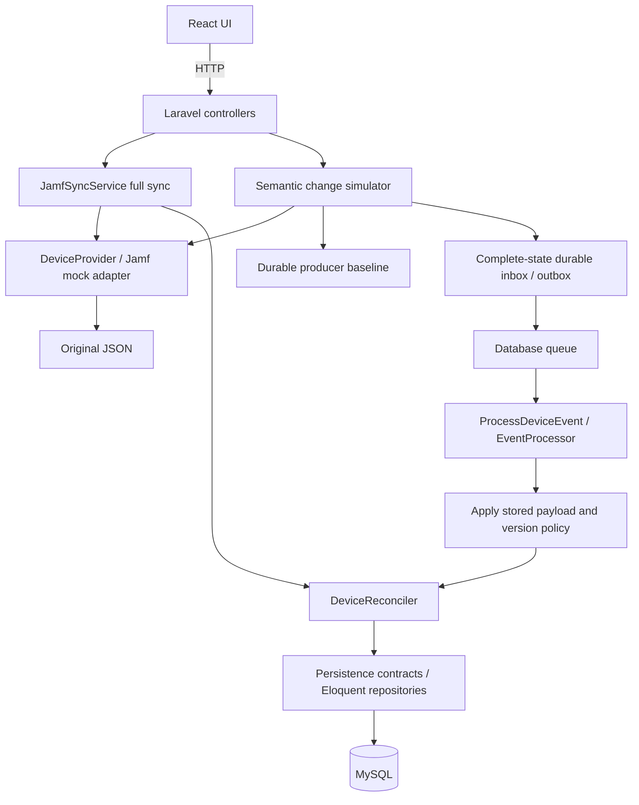
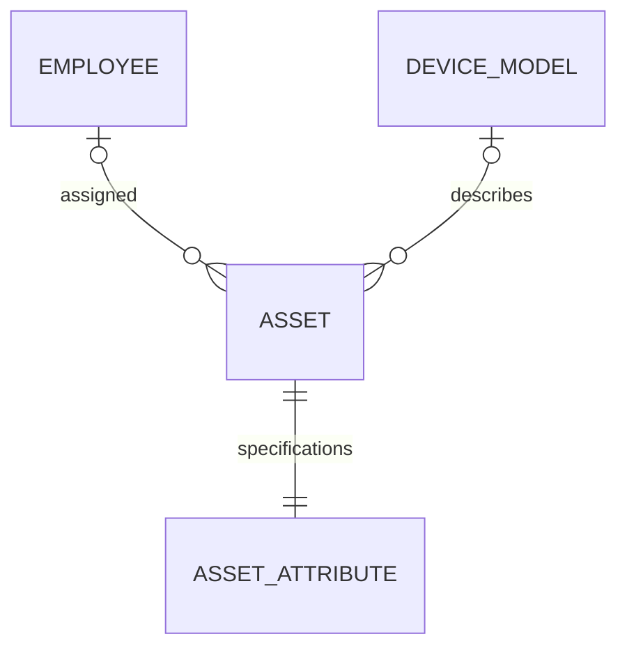

# Final state-carrying event solution

## Scope and architecture

Deliver Laravel + React + MySQL in Docker Compose. Full sync reads the original JSON directly and initially produces 7 assets / 6 employees. JamfSyncService is our Laravel class, not external Jamf. A hypothetical complete-state provider is demonstrated by a source-file simulator. No actual Jamf webhook behavior is asserted.

The worker does not connect to the provider/file. Controllers validate HTTP boundaries; services own sync policy; repositories own persistence; TransactionBoundary owns locked transactions. No generic repository base or Kafka/gRPC is required.

## Models

| Entity | Key fields and purpose |
|---|---|
| Employee | Internal ID; normalized unique email; name/phone; deletion timestamp |
| DeviceModel | Shared manufacturer + model identifier uniqueness; model name |
| Asset | Internal ID; unique serial; nullable employee/model FKs; device name, provider/device ID, purchase and report provenance |
| AssetAttributes | Unique asset FK with cascade; individual RAM/storage/processor/cores/battery |
| SyncRun | Mode/status/times/counters/error diagnostics |
| RestoreTask | Source identity and deleted time retained independently; pending/restored/missing/unassigned outcome |
| EventInbox | Unique event ID and provider/device/version; complete payload, content hash, generation, status/attempts/outcome |
| SimulatedProviderDevice | Durable per-device source baseline, semantic fingerprint, version/generation, last complete state, removal tombstone |
| MockProviderDevice | Separate source-store provider identity, serial, complete device JSON and lifecycle state |
| DeviceEventState | Applied per-device version/generation and state; survives asset deletion |
| SharedEventState | Employee/model identity, latest generation and metadata fingerprint |
| SimulatorGeneration | Monotonic provider-wide producer generation |
| SyncLock | Permanent provider row; database transaction owns lock lifetime |

No employee-assets join table is required for one current assignee. History and multi-tenant identities are future scope. Device-model descriptions are not assumed immutable. Individual specifications can differ/change.

## Provider and event contracts

DeviceProvider exposes complete snapshot and targeted identity lookup for future adapters. JamfMockProvider validates the envelope and maps to DeviceRecord. Explicit file import uses it. TargetedDeviceProvider is bound to MockProviderAdapter for indexed current-state lookup and provider reconciliation; queued payload processing uses neither adapter.

DeviceEvent contains event ID, provider-device ID, positive per-device version, producer_generation, lifecycle type and complete normalized device state. Complete state includes serial, nullable email, employee metadata, nullable shared model, asset metadata and specifications. All mapped keys must be present, with explicit nulls. Report date travels as provenance when a semantic change emits.

Lifecycle types: added, changed, unassigned, removed. Unassigned has null email; removed carries last-known complete state and serial. This is our simulator schema. External provider versions/authentication must be verified before a real integration.

## Producer algorithm

POST /api/simulator/jamf reads and validates the file, then compares normalized application-relevant state with the durable baseline under a provider lock. Initial simulation emits seven additions. Unchanged scans emit zero. ReportDate and lastContactTime alone do not trigger events. A real change emits even with unchanged reportDate; a changed event carries current report date. Source identity gaps fail simulation instead of inventing removal.

New/changed/unassigned/removed/reappearing records receive increasing device versions. One semantic batch gets a producer-global generation. Baseline/tombstones and complete inbox/outbox records commit atomically. Dispatch happens after commit; a pending-inbox recovery sweep closes dispatch gaps. A failure writing the outbox rolls back the baseline and generation too.

## Consumer ordering and transactions

Receipt validates the entire message and persists before 202. Exact event replay is safe; reused event ID or device/version with different content is 409. Worker decodes only stored payload. Older versions/generations complete as ignored. Equal applied versions with conflicting state fail. Newer state is reconciled and watermark/tombstone committed atomically with inbox success.

Removal validates serial/provider identity before deleting, preventing an ID from deleting a different asset. Removed/unassigned tombstones survive deletion, blocking stale resurrection. A newer reassignment/readdition can create the asset. Shared employee/model metadata has separate generation guards: older other-device events cannot regress it, and equal-generation conflicting metadata fails.

Full sync remains authoritative. It silently seeds/advances the simulator baseline and consumer watermarks in its reconciliation transaction, fencing obsolete queued messages. Thus unchanged simulation after full sync emits zero. Targeted local restoration is independent of provider changes; local deletion never advances producer state.

TransactionBoundary uses the same database connection and permanent lock row for nested receipt/full/worker/delete operations. No TTL can expire while reconciliation is active. Nested failure rolls back device/watermark/inbox changes; diagnostics persist in a separate locked transaction. Failed runs remain visible. Deadlock retries initialize counters per attempt.

## Chosen sync policies

- Only assigned source devices are imported. Existing unassigned or missing devices are removed locally after a validated complete snapshot; employees remain.
- Employee deletion retains ID/email and asset links as a tombstone. Source reconciliation reactivates the same employee identity.
- Local asset deletion cascades attributes and atomically stores a restore task; full sync or explicit targeted restoration recreates an assigned source device.
- Invalid/truncated snapshots, duplicate serial/provider IDs, conflicting existing identity or invalid nonempty email fail before destructive writes. Missing serial rows during full sync preserve known provider identities.
- Explicit null clears nullable mapped values; missing optional fields preserve during full sync where supported. Events carry complete values. Source shared metadata uses deterministic lexicographic provider-ID precedence with warnings.
- Asset counters track asset/specification persistence changes; shared employee/model updates are separate data. RAM conversion follows MB / 1024; storage absent in the original fixture stays unknown.

These are documented implementation choices, not pending approval gates.

## Persistence boundary and schema

Contracts live in app/Contracts/Persistence; Eloquent implementations in app/Repositories/Eloquent. AssetRepository owns the asset/specifications aggregate; separate repositories own employees, models, runs, restorations, inbox/state and locks. EventStateRepository stores baseline and watermarks but does not choose version policy. Policy stays in simulator/consumer/shared-metadata services.

Services/controllers/jobs do not invoke Eloquent queries or model save/update/delete methods. Contracts pragmatically return Eloquent records and Laravel collections/paginators, so a future ORM replacement still needs DTO migration. Schema remains in database/migrations. Laravel's framework queue persistence is unchanged.

## API and UI

Assets list/details, employee list with asset links, local delete confirmations, full Sync Now, activity outcomes, explicit restoration and retry. Activity's Scan source and queue changes calls POST /api/simulator/jamf; it does not run full sync automatically. GET /api/events shows versions/generations/outcomes. POST /api/events/jamf accepts complete state, and POST /api/events/{id}/retry requeues failures.

## Verification and boundaries

Substantive tests cover required sync behavior, source-free worker/retry with broken file, ignored timestamps, same-timestamp hardware updates, duplicate/version conflicts, tombstones, shared ordering, full-sync fencing, outbox/baseline atomic rollback and acknowledgment rollback. Frontend build and Docker/MySQL runtime checks are reported with exact measured counts in README/delivery.

Future work: verified Jamf complete-event semantics/authentication, tenant scope, scheduled authoritative reconciliation, retention/stale-run cleanup and operational monitoring. No real webhook integration or provider sequence guarantee is invented. Legacy ID-only pending records fail validation visibly. Kafka/serverless are deployment options beyond this local demonstration.

## Final provider CRUD and restoration roadmap

1. Add an indexed mock-provider store seeded once from the original fixture, a repository and target adapter. It is a separate logical provider boundary hosted in the same local Laravel process/database; it is not real Jamf.
2. Expose provider GET-by-ID, POST, PATCH and DELETE. Meaningful mutations commit provider state and complete inbox/outbox notifications atomically. Timestamp-only patches update provider metadata without events. Partial PATCH preserves omitted properties; explicit null clears them.
3. Keep required direct-file full import explicit. File edits reach the provider store through import/scan. Normal Sync Now reconciles current provider state after seeding; a separate Import source JSON action performs the required file workflow and intentionally replaces current provider state.
4. Restore local deletions through indexed provider GET-by-ID, never a full JSON scan. Verify retained serial and fence device/shared metadata checkpoints before applying current state, so queued older state cannot undo restoration.
5. Normalize complete payloads by merging absent optional source fields with prior producer state, while explicit null clears and missing model identity preserves. Add the review regressions.
6. Employee local deletion becomes a minimal tombstone retaining ID/email; asset links remain and render Deleted user plus email. Active employee list excludes it; source sync restores it in place.
7. Verify provider CRUD -> durable payload -> worker -> inventory, target lookup without any file reads, tombstone identity and rollback/idempotence, then Docker/browser checks.

Provider mutations are developer simulator endpoints; they do not add manual create/edit to inventory UI. A raw mounted-file edit is not automatically a provider mutation until imported/scanned. Targeted restore reads the current provider store, which resolves the previous restoration ordering bug without reintroducing a hidden full-file read.

## Final implemented boundary

Provider CRUD uses `mock_provider_devices`, separate from inventory assets, in the same demonstration backend/database. Its adapter performs indexed provider-ID lookup; restoration never reads the JSON file or lists the provider fleet. A retained removed-provider checkpoint is returned internally even when the public GET returns 404, so restoration fences older queued upserts. Current-provider reconciliation and explicit direct-file import are distinct actions; file import intentionally refreshes provider state.

Employees use soft-deletion tombstones retaining only ID/email and deletion time; links remain, active lists exclude tombstones, and source reconciliation reactivates the same ID. This supersedes earlier unassignment-on-employee-deletion discussion. Presence-aware normalization merges omitted source fields with the producer baseline before emitting complete messages; explicit null still clears supported fields. Provider startup seeds once and migration backfills missing source rows without manufacturing events.
